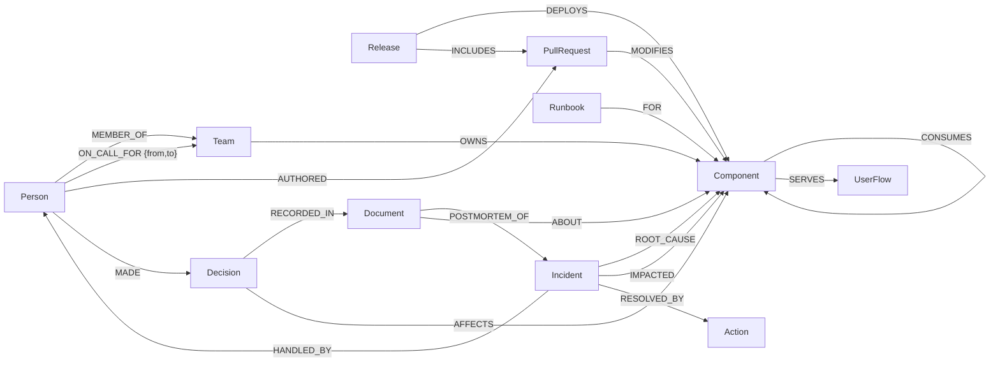

# Blast Radius

**AI on-call agents that run on a graph.** Blast Radius traces *why* production broke, *what* it affects and
*who* should fix it. It remembers every incident and shows the exact graph path behind each answer.
FalkorDB is the agents' shared brain: system topology, ownership, change history, incident memory and
agent checkpoints all live in it.

Built for **Graph Hacks 2026** (WeMakeDevs × FalkorDB).
**Tracks entered:** Agents That Act on Connected Data · Agent Memory and Coordination · Company Brain

> Status: in progress during the hackathon (Oct 15–18, 2026).

## Why a graph
Incident questions are relationship questions:
- *What breaks if `payment` goes down?* → everything that transitively depends on it
- *Ten services are alerting — which one is the cause?* → the dependency they all share
- *What changed near the failure?* → changes in the service **and its dependencies**
- *Who do I page?* → owner team → who is on call right now

Each is one traversal in FalkorDB. Remove FalkorDB and the agents have no topology, no memory and no evidence.

## Graph data model
One graph per tenant (`org_<tenant>`) in a single FalkorDB instance.



| Node | Key properties | Notes |
|---|---|---|
| `Component` (+ `Service` / `Datastore` / `Topic`) | name, tier, language/kind | Shared label lets one traversal cross services, databases and Kafka topics |
| `UserFlow` | name | Business view: browse, cart, checkout, order-processing |
| `Team`, `Person` | name; handle, role | Ownership and people (fictional) |
| `PullRequest`, `Release` | number, title, merged_at; version, deployed_at | Change history |
| `Incident`, `Action` | id, severity, opened_at, resolved_at, summary; kind, detail | Episodic and procedural memory |
| `Document`, `Decision`, `Runbook` | kind (postmortem/adr), body; rationale; steps | Company knowledge with sources |

**Edge direction:** dependency edges point from the dependent to its dependency
(`checkout -CALLS-> payment`). Walk forward for root cause, backward for blast radius.
**Time:** epoch seconds on nodes and edges (`merged_at`, `deployed_at`, `ON_CALL_FOR.from/to`).

The queries the product depends on are in [QUERIES.md](QUERIES.md).

## Data
- **System topology:** the [OpenTelemetry Demo](https://github.com/open-telemetry/opentelemetry-demo)
  (Astronomy Shop, Apache-2.0): 18 services, Valkey, PostgreSQL and a Kafka topic.
- **Company data:** synthetic and fictional (teams, people, PRs, releases, on-call, incidents, ADRs, runbooks),
  generated deterministically by [blastradius/data/synthetic.py](blastradius/data/synthetic.py).

## Local setup
Requirements: Docker, Python 3.12, [uv](https://docs.astral.sh/uv/).

```bash
# 1. Start FalkorDB (Browser UI at http://localhost:3000)
docker compose up -d

# 2. Create the virtual environment and install dependencies
uv venv blastradius-venv --python 3.12 --prompt blast-radius
# Windows: blastradius-venv\Scripts\activate    macOS/Linux: source blastradius-venv/bin/activate
uv sync --active

# 3. Configure
cp .env.example .env

# 4. Load the demo tenant graph
python -m blastradius.ingest --tenant astroshop --reset

# 5. Try the tools
python -m blastradius.cli blast payment
python -m blastradius.cli root-cause payment checkout frontend frontend-proxy
python -m blastradius.cli changes checkout --hours 24
python -m blastradius.cli page payment
python -m blastradius.cli experts payment

# 6. Tests (need FalkorDB running)
pytest
```

## AI usage disclosure
This project was built with help from an AI coding assistant (Claude Code), used for scaffolding,
boilerplate, test writing and debugging. The graph model, the queries and the design decisions were reviewed,
verified and are understood by the author. Details are kept up to date in this section.
