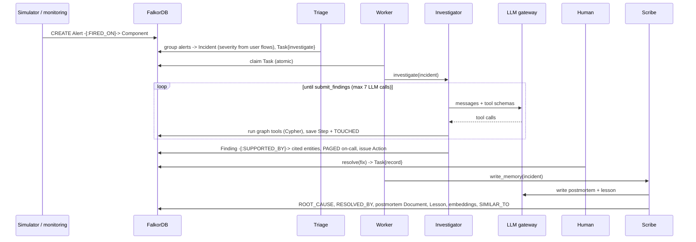

# Architecture

## Components
| Component | File(s) | Responsibility |
|---|---|---|
| FalkorDB | `docker-compose.yml` | The only database. One graph per tenant (`org_<tenant>`). |
| Ingest | `ingest.py`, `data/`, `schema.py`, `memory.py` | Loads topology and company data, creates indexes, derives `DEPENDS_ON`, stores PageRank, embeds incidents and documents, links similar incidents. |
| Queries | `queries.py` | All read Cypher used as agent tools ([QUERIES.md](../QUERIES.md)). |
| Incidents | `incidents.py` | Alerts, incident creation, the fault simulator. |
| Agent runtime | `agents/runtime.py`, `agents/store.py` | Tool-calling loop. Every step is saved in the graph, which gives resume and audit. |
| Agents | `agents/incident_agents.py` | Triage, investigator, scribe, company brain. |
| Tools | `agents/tools.py` | JSON-schema tool definitions wrapping the queries, with validation. |
| Worker | `agents/worker.py` | Claims `Task` nodes, runs the agent for each, resumes paused runs. |
| LLM gateway | `llm/` | Ordered provider slots, fallback, cooldowns, requests-per-minute budget. |
| Actions | `actions.py` | Page the on-call person, open a GitHub issue. Each happens once. |
| API | `api.py` | REST for the UI. Runs the worker thread and serves the built UI. |
| MCP | `mcp_server.py` | The graph tools and the brain agent, over the Model Context Protocol. |
| UI | `ui/` | React + Cytoscape console. |

## Incident flow

## Why these choices
| Decision | Alternative | Why |
|---|---|---|
| Agents coordinate **through the graph** (`Task` nodes) | Agents call each other in memory | Handoffs survive restarts, are visible and auditable, and several workers can share the load. |
| **Fixed Cypher tools**, no LLM-written Cypher | Text-to-Cypher | Reliable, safe, testable and cheap on tokens. The LLM's job is to choose and explain. |
| **Deterministic triage** | LLM triage | Grouping alerts and scoring severity need no judgement, so it costs zero LLM calls. |
| **Own agent loop** (~250 lines) | LangGraph / CrewAI | Checkpoints must live in FalkorDB, and every line needs to be explainable. |
| **Derived `DEPENDS_ON` edge** | Run algorithms per edge type | FalkorDB algorithms take one relationship type. The derived edge also records `via`. |
| **Local embeddings** (bge-small, 384-d) | Embedding API | Free, no rate limits, works offline. Groq has no embeddings API. |
| **Vector + structure** similarity | Vector only | "Same root-cause component" is a stronger signal than wording. |
| **Times as epoch ints, shown as "2h ago" to the LLM** | Datetime strings | Fast range filters in Cypher. LLMs misread raw epochs, which we saw in testing. |
| **Evidence = cited entities** | Everything the agent looked at | Shows *why*, not everything the agent read. |
| **One graph per tenant** | Tenant property on every node | Real isolation, simpler queries, FalkorDB multigraph. |
| **OpenAI-compatible gateway** | One SDK per provider | Groq, Gemini, OpenRouter, Ollama and others share one client and one fallback path. |

## Failure handling
| Failure | Behaviour |
|---|---|
| Model rate-limited (429) | That model cools down for `retry-after` seconds, then the next model or provider is tried. |
| Provider down or timing out | Provider cooled down for 30 s, next provider tried. |
| Invalid key | Provider disabled for the process. |
| Every provider unavailable | Run saved as `paused` with `resume_at`. The worker resumes it from the last completed step. |
| Process crash mid-run | On restart, the conversation is rebuilt from `Step` nodes. Tool calls that never ran are run first. |
| Model returns invalid tool arguments or an invalid root cause | The error goes back to the model as the tool result so it can correct itself. |
| Model never finishes | After the step budget it is told to submit; if it still doesn't, the run is marked failed. |
| Duplicate side effects | Page and issue `Action` nodes have deterministic ids and are created only once. |

## Deployment
- **Local:** `docker compose up -d` for FalkorDB, plus `uvicorn blastradius.api:app --port 8007`. Or run
  `docker compose --profile app up -d --build` for everything.
- **Cloud:** one container from the `Dockerfile` (UI + API + worker) and a FalkorDB instance, either FalkorDB Cloud
  or a container. Set `FALKORDB_HOST/PORT/USERNAME/PASSWORD`, `GROQ_API_KEY` and `SEED_ON_START=1`. The demo
  tenants are created on first start.
- **Ports:** UI and API 8007, UI dev server 3007, FalkorDB 6379, FalkorDB Browser 3006.
