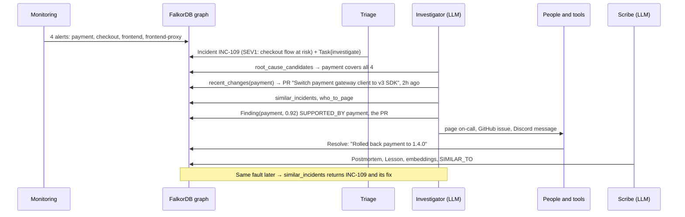

# Blast Radius: design document

From the problem to the solution: what we are trying to achieve, why it is built this way, how it works, how we know
it works, and what it does not do yet. Terms in *italics* are explained in the [glossary](#15-glossary).

| | |
|---|---|
| **Status** | Working prototype, evaluated (8/8 root causes correct), tested (52 tests) |
| **Built for** | Graph Hacks 2026 (WeMakeDevs × FalkorDB): Agents That Act on Connected Data, Agent Memory and Coordination, Company Brain |
| **Stack** | FalkorDB · Python 3.12 · FastAPI · React + Cytoscape · free-tier LLMs (Groq first) · local embeddings |
| **Related docs** | [ARCHITECTURE](ARCHITECTURE.md) · [GRAPH_MODEL](GRAPH_MODEL.md) · [AGENTS](AGENTS.md) · [CONNECTORS](CONNECTORS.md) · [EVALUATION](EVALUATION.md) · [QUERIES](../QUERIES.md) |

---

## 1. Summary
When production breaks, many services alert at once, but usually only one is the *root cause*. The engineer *on
call* has to work out which one, what changed, who owns it, and whether it has happened before. The facts are spread
over monitoring, Git, on-call schedules, runbooks and old *postmortems*.

**Blast Radius** puts those facts into one knowledge graph in FalkorDB and lets a small team of AI agents work on it.
The agents trace the alerts to a root cause, find the change that likely caused it, page the right person, open a
GitHub issue and post to the team's chat. Every step and every piece of evidence is saved in the same graph. When
the incident is resolved, the fix becomes memory, so the same fault is solved faster next time. The same graph also
answers everyday questions like "who knows this service?" or "why is it built this way?".

---

## 2. Problem statement

### 2.1 What happens today
A typical incident at a company with a few dozen *microservices*:

1. **Alert storm.** One service fails. Every service that depends on it starts failing too, so 5–10 alerts fire
   within a minute. They all look urgent.
2. **Finding the cause.** The on-call engineer opens dashboards, traces and logs, and tries to find what all the
   failing services have in common. That's the dependency structure, which mostly lives in people's heads or in an
   outdated diagram.
3. **Finding the change.** Most incidents follow a change. Someone searches recent deploys and pull requests in the
   suspected service *and its dependencies*.
4. **Finding the people.** Who owns the service? Who is on call for that team *this week*? Who actually knows the
   code? Those are three different answers, from three different tools.
5. **Remembering.** "Didn't this happen last month?" The postmortem exists, but nobody finds it at 2 AM.
6. **Knowledge loss.** After the incident, the lesson is written into a document that is rarely read again.

The time spent on steps 2–5 is the main driver of *MTTR* (mean time to resolve).

### 2.2 Why it is hard
Each question above is a **relationship question**:

| Question | Relationships needed |
|---|---|
| What's the root cause? | service → depends on → service, several hops deep |
| What breaks if X fails? (its *blast radius*) | the same edges, walked backwards |
| What changed near the failure? | pull request → modifies → service, for X **and** its dependencies |
| Who do I page? | service ← owned by ← team ← on call ← person, filtered by date |
| Who knows it? | person → authored → pull request → modifies → service, counted |
| Seen it before? | incident → root cause → service, plus text similarity |

Tables and documents store these facts in separate places. Answering a multi-hop question means joining across
systems, by hand, under pressure.

### 2.3 Why existing AI assistants are not enough
A chatbot over documents (*RAG* on text chunks) can summarise a runbook, but:
- **It guesses structure.** It has no reliable dependency graph, so "what do these 8 alerts have in common?" is a
  guess.
- **It forgets.** Each conversation starts from zero. Last month's incident is not connected to this one.
- **It can't show its work.** An answer without the path behind it is hard to trust during an incident.
- **It doesn't coordinate.** Several agents passing text to each other in memory lose everything on a crash or a
  rate limit.

### 2.4 Problem statement (one sentence)
> On-call engineers lose the first, most expensive minutes of an incident reconstructing relationships between
> services, changes, people and past incidents. AI agents could do this work, but only if they have a reliable,
> shared, explainable model of those relationships, and memory that outlives a single conversation.

---

## 3. Goals and non-goals

### Goals
1. **Find the root cause** of a multi-service failure from alerts alone, including causes that never alert themselves.
2. **Act:** page the right person, open a tracking issue, notify the team channel, all without duplicates.
3. **Explain:** every conclusion links to the exact graph entities and Cypher queries behind it.
4. **Remember:** a resolved incident makes the next similar one faster and better.
5. **Coordinate reliably:** agents hand off work through the graph and survive crashes and LLM rate limits.
6. **Answer company questions** (owners, experts, decisions, knowledge risk) with sources.
7. **Work on real data**, not only on a demo: GitHub repositories and real alert webhooks.
8. **Run for free:** free-tier LLMs, local embeddings, one Docker container for the database.

### Non-goals (for this version)
- Replacing monitoring. We consume alerts; we don't collect metrics or traces.
- Fixing production automatically. The agent *recommends* a fix and a human applies it.
- Private repositories or enterprise single sign-on.
- A production-grade paging service (phone calls, escalation policies).

---

## 4. Users and use cases
| User | Moment | What they need | Where in the product |
|---|---|---|---|
| **On-call engineer** | 2 AM, alerts firing | The cause, the suspect change, who to involve, the past fix | Investigation tab, graph overlay, chat message |
| **Incident commander** | During a SEV1 | Severity, impacted user flows, who's been paged | Incident header, actions card |
| **Engineer after the incident** | Resolving | A postmortem and a lesson without writing them from scratch | Resolve box → scribe agent |
| **New engineer** | First weeks | "Who knows payment? Why Kafka here?" | Ask the company brain |
| **Engineering manager** | Planning | Services only one person understands (*bus factor*), critical services | Company brain, PageRank sizes |
| **Another AI tool** (Claude Desktop, Cursor) | Any time | The same graph tools | MCP server |

---

## 5. Requirements

### Functional
| # | Requirement | How it's met |
|---|---|---|
| F1 | Group alerts into an incident with a severity | Deterministic triage; severity from the *user flows* at risk |
| F2 | Rank root-cause candidates | Multi-hop Cypher ranking (§8.1) + LLM investigator |
| F3 | Find recent changes near the cause | PRs on the component and its dependencies, by time window |
| F4 | Page the right person | On-call rotation for the owning team; falls back to the top expert |
| F5 | Open an issue, notify chat | GitHub Issues API, Slack/Discord incoming webhooks |
| F6 | Learn from resolution | Scribe agent writes postmortem, lesson, embeddings, `SIMILAR_TO` links |
| F7 | Recall similar incidents | Vector search + graph structure (§8.3) |
| F8 | Answer organisational questions with sources | Company-brain agent with 15 read tools |
| F9 | Load real systems | GitHub connector; Alertmanager-compatible webhook |
| F10 | Separate organisations | One graph per tenant |

### Non-functional
| # | Requirement | How it's met |
|---|---|---|
| N1 | **Explainable** | Steps with `TOUCHED` edges; findings `SUPPORTED_BY` cited entities; "show Cypher" in the UI |
| N2 | **Resilient to LLM limits** | 7-slot provider fallback, cooldowns, pause and resume from graph checkpoints |
| N3 | **Crash-safe** | Conversation rebuilt from `Step` nodes; tasks claimed atomically |
| N4 | **No duplicate side effects** | Deterministic `Action` ids per incident |
| N5 | **Cheap** | Graph does the heavy work; 4–7 LLM calls per investigation; local embeddings |
| N6 | **Private by default** | GitHub logins pseudonymised; secrets only in `.env`; webhook URLs never stored |
| N7 | **Testable** | Fixed Cypher tools (no LLM-written queries); 52 tests; evaluation harness with hidden ground truth |

---

## 6. Solution overview: one incident, end to end
Example: the payment service starts failing after a pull request switched it to a new SDK.

1. **Alerts arrive** from the simulator or a real webhook and are stored as `Alert` nodes on the components.
2. **Triage** (no LLM) groups them into an incident. Severity comes from the user flows the alerting components
   serve: checkout at risk means SEV1. It creates a `Task{investigate}`.
3. **A worker claims the task** with one atomic Cypher query and starts the **investigator**.
4. **The investigator** (LLM) chooses graph tools. The tools are fixed, tested Cypher queries. The LLM picks which to
   run and writes the conclusion. Typical sequence: root-cause candidates → recent changes → similar incidents →
   who to page → submit.
5. **The graph checks the answer.** If another component explains more of the alerts, the answer is sent back once.
6. **Actions:** the on-call person is paged (`PAGED` edge), a GitHub issue is opened, and the team channel gets a
   message. Each action happens exactly once.
7. **A human resolves** the incident with the fix. A `Task{record}` hands it to the **scribe**, which writes the
   postmortem and a lesson, and links the incident to similar ones.
8. **Next time**, `similar_incidents` finds this incident and its fix, and the investigator cites it.

---

## 7. Why a graph, and why FalkorDB

### 7.1 Options considered
| Option | Multi-hop questions | Memory across incidents | Explainability | Verdict |
|---|---|---|---|---|
| LLM with documents in the prompt | Guessed | None | Weak | Not reliable enough for root cause |
| Vector database (RAG) | Not supported: similarity, not structure | Text only | Weak | Good for "seen this before?", not for "what depends on what?" |
| Relational database | Recursive SQL, hard to write and slow on deep paths | Possible | Medium | Workable but awkward |
| **Graph database** | **Native: variable-length paths** | **Incidents linked to components, fixes, people** | **The path *is* the explanation** | **Chosen** |

### 7.2 Why FalkorDB specifically
- **Speed for agent loops.** An agent runs a query on every step, so queries must be fast. FalkorDB stores the graph
  as sparse matrices and is fast enough to query on every step.
- **Everything in one place.** Cypher, graph algorithms (PageRank, shortest paths, label propagation), a **vector
  index** and a **full-text index** in the same engine. Similar-incident search is one query mixing vectors and
  structure.
- **Many graphs in one instance.** One graph per organisation gives real tenant isolation with no extra servers.
- **Simple to run.** One Docker container, Redis protocol, a browser UI for inspection.

**Remove FalkorDB and nothing works:** there would be no topology, no memory, no checkpoints, no hand-offs and no
evidence.

---

## 8. Core techniques

### 8.1 Root-cause ranking (the central idea)
A candidate is any component reachable **forward** from the alerting components, 0 to 6 hops. 0 hops means an
alerting component can be its own cause. Candidates are ranked by:

1. **covers:** how many alerting components depend on it. A true cause should explain all the symptoms.
2. **is_alerting:** it shows symptoms itself.
3. **alerting_deps (fewer is better):** if its own dependencies are alerting, it's probably a victim too.
4. **recent_changes:** PRs merged in the time window.

It finds causes that never alert. In the `kafkaQueueProblems` fault, two services alert that don't call each
other. The only thing they share is the Kafka topic `orders`, which has no alert of its own. Full query:
[QUERIES.md Q2](../QUERIES.md).

### 8.2 Blast radius, criticality, paths
- **Blast radius:** everything that transitively depends on X, walked backwards, with the user flows at risk.
- **Criticality:** `algo.pageRank` over the derived `DEPENDS_ON` edge. A service many others depend on scores high.
  The UI sizes nodes by it.
- **Path to user:** `algo.SPpaths` from the entry point to X. It shows how a failure reaches customers, and the UI
  draws the red failure paths.
- **Clusters:** `algo.labelPropagation` groups services that work closely together.

### 8.3 Similar incidents: vectors plus structure
`score = 0.6 × text similarity + 0.3 × same root-cause component + 0.1 × overlap of impacted components`

Text similarity alone confuses "payment errors" with "payment latency". The structural terms come from the graph.
Embeddings are local (`bge-small-en-v1.5`, 384 dimensions), so recall is free and has no rate limit. FalkorDB returns
cosine *distance*, so similarity is `1 − score`.

### 8.4 Knowledge risk (*bus factor*)
For each component, count the distinct people who changed it. One person means the knowledge is at risk.

---

## 9. Agents, coordination and memory

### 9.1 The agents
| Agent | LLM? | Job |
|---|---|---|
| Triage | No | Alerts → incident + severity + investigate task |
| Investigator | Yes, ≤ 7 calls | Root cause, suspect change, actions |
| Scribe | Yes, 1 call | Postmortem, lesson, memory links |
| Company brain | Yes, ≤ 6 calls | Answers questions with sources; remembers the last 3 turns of a session |

Triage has no LLM on purpose: grouping alerts needs no judgement, and it saves a call on every incident.

### 9.2 Tools, not text-to-Cypher
The LLM never writes Cypher. It chooses from 16 named, tested read tools plus one "final answer" tool per agent.
That makes the system **safe** (no arbitrary queries), **testable** (each tool has tests), **cheap** (short
prompts) and **explainable** (the UI shows the exact query behind each step).

### 9.3 Coordination through the graph
Agents never call each other. They create `Task` nodes, and a worker claims one with a single Cypher query.
FalkorDB runs writes to a graph one at a time, so two workers can't claim the same task. Hand-offs survive restarts,
are visible in the graph, and can be spread over several worker processes.

### 9.4 Checkpoints: the agent's state is graph data
Every LLM response and tool result is a `Step` node, chained with `NEXT` to the previous one. Tool steps have
`TOUCHED` edges to the nodes they read. Consequences:
- **Pause and resume.** When every LLM provider is rate-limited, the run is marked `paused` with a resume time. Later,
  the conversation is rebuilt from the steps and continues. Nothing is re-queried.
- **Crash recovery.** The same rebuild happens after a process crash. Tool calls that never ran are run first.
- **Audit.** "Which incidents did the agent look at this PR for?" is a query.

### 9.5 Memory types
| Type | Meaning | In the graph |
|---|---|---|
| Episodic | What happened | `Incident`, `Alert`, `Finding`, `Action`, `SIMILAR_TO` |
| Semantic | How things are | Topology, owners, PRs, decisions, documents |
| Procedural | How to fix | `Runbook`, `Lesson`, fix actions |
| Conversational | What we just discussed | Brain runs grouped by session |

### 9.6 Guardrails
- **Validation:** the root cause must be a real component; confidence must be between 0 and 1.
- **Graph consistency check:** a root cause that explains fewer alerts than another candidate is sent back once
  with the numbers. The graph advises, it doesn't veto.
- **Step budget:** after 7 calls, the model is told to submit and offered only the final-answer tool.
- **Readable times:** timestamps become "2h ago" before the LLM sees them. Small models misread raw epoch numbers.

---

## 10. Reliability on free-tier LLMs
The LLM gateway tries provider slots in order (Groq → Gemini → OpenRouter → OpenAI → Claude → custom → Ollama), and
several models within each. Errors are classified:

| Error | Response |
|---|---|
| Rate limited (429) | That model cools down for `retry-after`; the next model is tried |
| Provider down / timeout | The provider cools down for 30 s |
| Bad key | The provider is disabled |
| Model not found | The model is disabled |
| Bad request / refusal | The next model is tried |
| Everything unavailable | The run pauses and resumes later from its checkpoint |

A per-provider requests-per-minute budget keeps calls under free-tier limits before they're hit.

---

## 11. Real data
- **GitHub connector:** any public repo becomes a tenant graph. Services and dependencies come from its compose
  files, including hostnames in environment variables. Owners come from `CODEOWNERS`; changes and experts from
  merged PRs mapped to components by file path; design decisions from ADR files. Tested on the OpenTelemetry Demo
  repo: 26 components, 43 dependencies.
- **Alert webhook:** Prometheus Alertmanager format (also what Grafana sends) or plain JSON. Labels such as
  `service`, `app` or a pod name are matched to components. Unknown names are reported, never guessed.
- **Outbound actions:** GitHub issues (fine-grained token, one repo, Issues only), Slack and Discord incoming
  webhooks.

Details: [CONNECTORS.md](CONNECTORS.md).

---

## 12. Security and privacy
| Risk | Mitigation |
|---|---|
| Leaked secrets | Keys, tokens and webhook URLs live only in `.env`, which git ignores. Webhook URLs are never written to the graph or logs. |
| Over-privileged token | The GitHub token is fine-grained: one repository, Issues permission only. It expires. |
| Personal data | GitHub logins become stable pseudonyms (`dev-` + salted hash) unless `--real-names` is chosen. Demo company data is fictional. |
| Prompt injection via data | The LLM can only call fixed read tools and one final-answer tool. It cannot write arbitrary queries or take actions directly; actions are code paths after validation. |
| Cross-tenant leaks | Each organisation is a separate graph; every query is scoped to one graph. |
| Runaway agent | Step budget, validation, and a human resolves the incident. |

---

## 13. Evaluation
`python -m blastradius.eval` injects each of the OpenTelemetry Demo's 8 fault flags into a fresh graph, runs the real
investigator on free-tier models, and compares the answer with hidden ground truth (a `Scenario` node no agent tool
reads). It then resolves the incident and injects the same fault again.

| | First occurrence | Same fault again |
|---|---|---|
| Root cause correct | 8/8 | 8/8 |
| Cited the incident it just learned from | — | 7/8 |
| Avg LLM calls / graph queries | 5.6 / 4.5 | 5.0 / 4.8 |

During that run, free-tier limits caused 24 model fallbacks and 34 full pauses; every paused run resumed and
finished. Full results: [EVALUATION.md](EVALUATION.md).

**What this does and doesn't prove.** It shows the ranking, the agent loop and memory work on a realistic topology
with known answers. It is not a production study: the faults are simulated, there are 8 of them, and real incidents
are messier (partial outages, several causes at once, missing dependencies).

---

## 14. Limitations and future work

### Limitations
- Dependencies come from compose files or a catalog, not from live traffic. A missing edge means a missed cause.
- One root cause per incident. Simultaneous independent failures are not separated.
- Paging is a graph record plus a chat message, not a phone call with escalation.
- Public GitHub repos only.
- Free-tier LLM limits make runs slower during bursts. They pause and resume, but a demo can take minutes.

### Future work
1. **Live dependencies from OpenTelemetry traces**, so the graph matches real traffic.
2. **Learn ranking weights** from resolved incidents (which signals actually predicted the cause).
3. **Approved remediation:** the agent proposes a rollback or feature-flag change, a human approves, the agent runs it.
4. **More sources:** Kubernetes, deploy pipelines, PagerDuty schedules, Backstage catalogs.
5. **Change risk before merge:** "this PR touches a service with bus factor 1 and a high blast radius".

---

## 15. Glossary
| Term | Meaning |
|---|---|
| **On call** | The engineer responsible for responding to alerts during a time window, usually rotating weekly. |
| **Paging** | Urgently notifying the on-call person (phone, push, chat). |
| **Incident** | An unplanned problem affecting users. Has a severity, a timeline and an owner. |
| **SEV1 / SEV2 / SEV3** | Severity levels. SEV1 = core user flow broken (e.g. checkout); lower numbers are worse. |
| **Root cause** | The component or change whose failure explains the symptoms. Others are *victims*. |
| **Root-cause analysis (RCA)** | The process of finding the root cause. |
| **Blast radius** | Everything affected if a component fails: its direct and indirect dependents. |
| **Alert storm** | Many alerts at once from one underlying failure. |
| **MTTR** | Mean time to resolve (or recover): the average time from start to fix. The key incident metric. |
| **Postmortem** | A written review after an incident: what happened, why, the fix, how to prevent it. Usually "blameless". |
| **Runbook** | Step-by-step instructions for handling a known problem. |
| **ADR** | Architecture Decision Record: a short document explaining why a design decision was made. |
| **CODEOWNERS** | A GitHub file mapping paths in a repo to the people or teams who own them. |
| **Microservices** | An architecture where a product is many small services that call each other over the network. |
| **User flow** | A user-facing journey such as browsing, cart or checkout, served by several services. |
| **Alertmanager** | The Prometheus component that groups and routes alerts, for example to a webhook. |
| **OpenTelemetry** | An open standard for traces, metrics and logs. Its demo shop is our reference topology. |
| **Bus factor** | How many people would have to leave before nobody understands a component. 1 is a risk. |
| **PageRank** | A graph algorithm scoring nodes by how many important nodes point to them. Here: how many services depend on one. |
| **Knowledge graph** | Facts stored as nodes (things) and edges (relationships) that can be queried by following connections. |
| **Cypher** | The query language for property graphs, used by FalkorDB. |
| **Embedding** | A vector of numbers representing the meaning of a text, so similar texts have nearby vectors. |
| **RAG** | Retrieval-augmented generation: fetching relevant data and giving it to an LLM before it answers. |
| **GraphRAG** | RAG where the retrieval follows graph relationships instead of (or as well as) text similarity. |
| **Tool calling** | An LLM asks the program to run a named function with arguments and gets the result back. |
| **MCP** | Model Context Protocol: a standard way to expose tools to AI apps such as Claude Desktop or Cursor. |
| **Checkpoint** | Saved state that lets a long task continue after a pause or crash. |
| **Idempotent** | Doing it twice has the same effect as doing it once (no duplicate pages or issues). |
| **Tenant** | One customer organisation in a shared system. Here, each has its own graph. |
| **AIOps** | Using machine learning and AI in IT operations: alert correlation, root-cause analysis, automation. |
